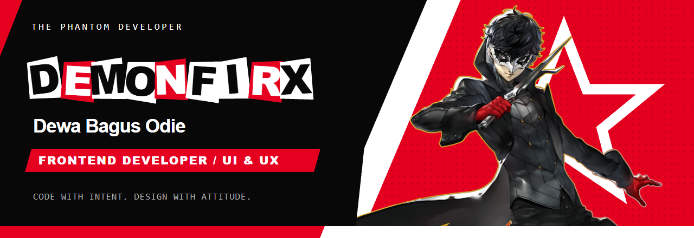
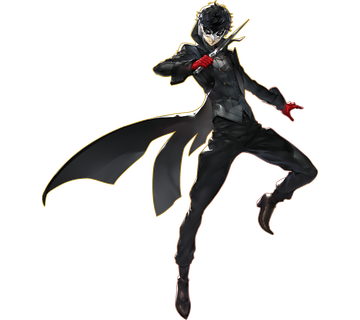
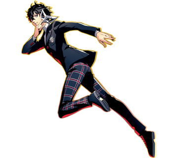
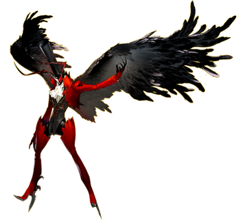
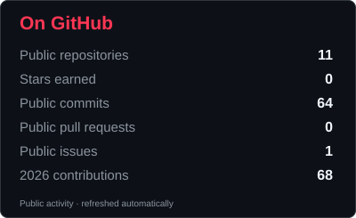
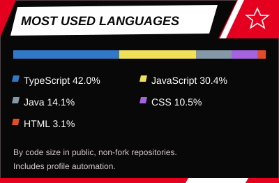

<picture>
  <source media="(max-width: 600px)" srcset="assets/header-joker-mobile.png">
  
</picture>

  <a href="https://natyournatsu.xyz"><strong>PORTFOLIO ↗</strong></a>
  &nbsp; / &nbsp;
  <a href="https://github.com/demonfirx?tab=repositories"><strong>REPOSITORIES ↗</strong></a>

### About me

<picture>
  <source media="(prefers-reduced-motion: reduce)" srcset="assets/joker-still.png">
  
</picture>

I'm **Odie**, a frontend developer and UI/UX enthusiast from Indonesia. I build web interfaces, work with motion, and make browser games on the side.

My projects range from a personal portfolio to a Pokémon battle engine. I like sharp typography and small details that make an interface feel good to use.

**Currently exploring:** interactive web experiences and game mechanics.

 

<h3 align="center">Tools &amp; technologies</h3>

  <strong>Backend and API</strong>  
  

  <strong>Cloud and DevOps</strong>  
  

  <strong>IoT and Frontend</strong>  
  

<h3 align="center">Web Pages</h3>

<table>
  <thead><tr>
    <th align="center" width="33%"><a href="https://natyournatsu.xyz">Portfolio ↗</a></th>
    <th align="center" width="33%"><a href="https://pokemon-battle-beta.vercel.app">Games ↗</a></th>
    <th align="center" width="33%"><a href="https://github.com/demonfirx?tab=repositories">Code ↗</a></th>
  </tr></thead>
  <tbody><tr>
    <td align="center"></td>
    <td align="center"></td>
    <td align="center"></td>
  </tr></tbody>
</table>

### Selected projects

| Project | What I built |
| :--- | :--- |
| [**ODIE Portfolio**](https://github.com/demonfirx/CV-DewaBagusOdie-v2) | A personal portfolio built with React, TypeScript, Tailwind CSS, and Motion. [Visit ↗](https://natyournatsu.xyz) |
| [**Pokémon Battle**](https://github.com/demonfirx/Pokemon-battle) | A turn-based battle engine with type effects and a smart opponent. [Play ↗](https://pokemon-battle-beta.vercel.app) |
| [**RoughSketch UI**](https://github.com/demonfirx/RoughSketch-UI) | A tool for turning hand-drawn wireframes into generated interfaces. [Try it ↗](https://roughsketch-ui.vercel.app) |
| [**Nintendo Retro**](https://github.com/demonfirx/Nintendo-Retro) | A retro web tribute to Nintendo. [Explore ↗](https://nintendo-retro.vercel.app) |

### On GitHub

  
  

<!-- activity:start -->

<strong>2026</strong> · 70 contributions · Best streak: 3 days

<!-- activity:end -->

<picture>
  <source media="(prefers-reduced-motion: reduce)" srcset="assets/generated/activity-static.svg">
  
</picture>

  <strong>Take your time.</strong> 
  <a href="https://natyournatsu.xyz">Explore my work &amp; get in touch ↗</a>

Statistics and animations refresh automatically six times a day. Activity includes automated profile maintenance commits.

Artwork: [ATLUS / Persona 5 Royal](https://p5r.jp/character/hero/). GIF: [Persona 5 via Tenor](https://tenor.com/view/joker-joker-persona5-gif-21179047). [Skill Icons](https://github.com/tandpfun/skill-icons) · [Snake](https://github.com/Platane/snk). Persona © ATLUS / SEGA. Personal fan profile.
