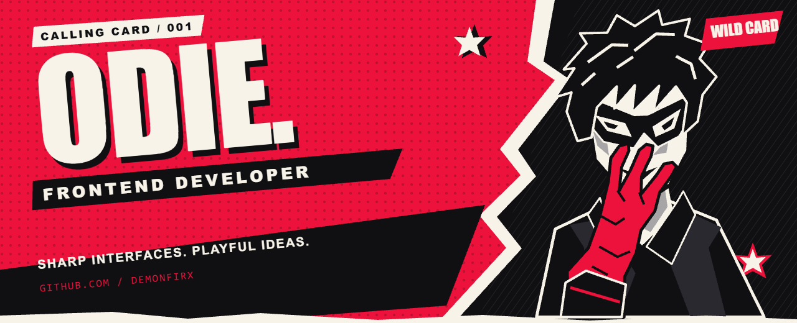
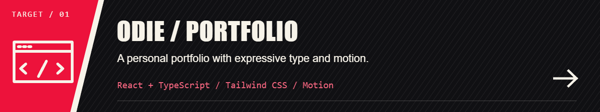
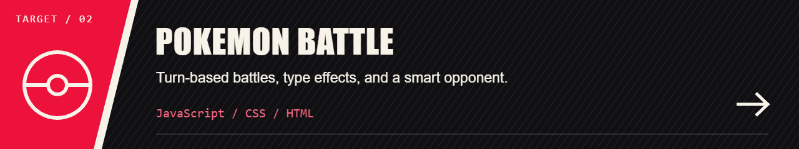
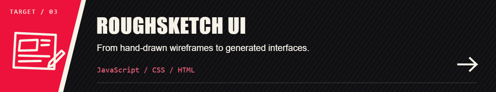
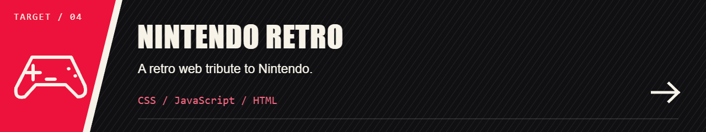

<picture>
  <source media="(max-width: 600px)" srcset="assets/calling-card-mobile.png">
  
</picture>

  <strong>Dewa Bagus Odie · @demonfirx</strong> 
  Expressive web interfaces, thoughtful motion, and a soft spot for browser games.

  
  

### Behind the mask

I'm Odie, a frontend developer who enjoys giving websites a little personality. My projects range from animated portfolios to a turn-based Pokémon battle engine. I care about how an interface looks, moves, and responds when you use it.

**My usual toolkit:** `React` `TypeScript` `JavaScript` `Tailwind CSS` `Vite` `Motion`

### Selected operations

<a href="https://github.com/demonfirx/CV-DewaBagusOdie-v2">
  <picture><source media="(max-width: 600px)" srcset="assets/portfolio-mobile.png"></picture>
</a>

[Live portfolio](https://natyournatsu.xyz) · [Source code](https://github.com/demonfirx/CV-DewaBagusOdie-v2)

<a href="https://github.com/demonfirx/Pokemon-battle">
  <picture><source media="(max-width: 600px)" srcset="assets/pokemon-mobile.png"></picture>
</a>

[Play the demo](https://pokemon-battle-beta.vercel.app) · [Source code](https://github.com/demonfirx/Pokemon-battle)

<a href="https://github.com/demonfirx/RoughSketch-UI">
  <picture><source media="(max-width: 600px)" srcset="assets/roughsketch-mobile.png"></picture>
</a>

[Try RoughSketch](https://roughsketch-ui.vercel.app) · [Source code](https://github.com/demonfirx/RoughSketch-UI)

<a href="https://github.com/demonfirx/Nintendo-Retro">
  <picture><source media="(max-width: 600px)" srcset="assets/nintendo-mobile.png"></picture>
</a>

[Visit the demo](https://nintendo-retro.vercel.app) · [Source code](https://github.com/demonfirx/Nintendo-Retro)

### Make your next move

See something you like? Visit [my portfolio](https://natyournatsu.xyz) to explore more of my work and get in touch.

Personal fan tribute inspired by Persona 5 / Joker. Original vector artwork. Persona belongs to ATLUS / SEGA.
