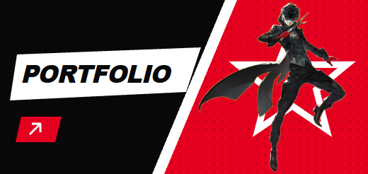
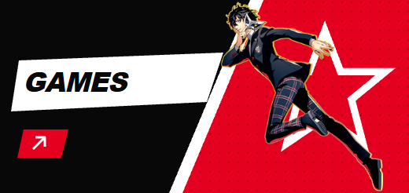
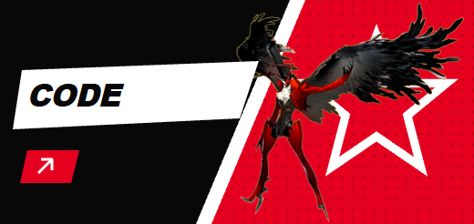
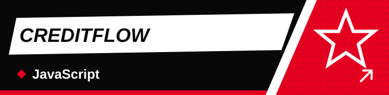
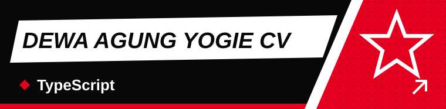
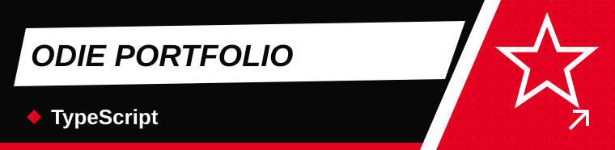
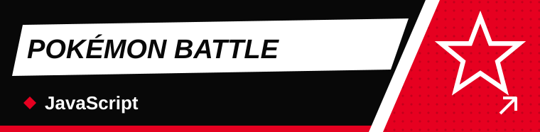

<picture>
  <source media="(max-width: 600px)" srcset="assets/header-joker-mobile.png">
  
</picture>

  <a href="https://natyournatsu.xyz"><strong>PORTFOLIO ↗</strong></a>
  &nbsp; / &nbsp;
  <a href="https://github.com/demonfirx?tab=repositories"><strong>REPOSITORIES ↗</strong></a>

<h3><picture>
  <source media="(max-width: 600px)" srcset="assets/profile/about-me-mobile.png">
  
</picture></h3>

<picture>
  <source media="(prefers-reduced-motion: reduce)" srcset="assets/joker-still.png">
  
</picture>

I'm **Odie** (`demonfirx`), a frontend developer and UI/UX enthusiast from Indonesia. Sharp type and motion are my calling card.

I build web interfaces and make browser games on the side. My [Pokémon battle engine](https://github.com/demonfirx/Pokemon-battle) is where I get to tinker with turn-based rules.

**Next mission** · Explore more interactive web experiences and game mechanics.

 

<h3><picture>
  <source media="(max-width: 600px)" srcset="assets/profile/tech-stack-mobile.png">
  
</picture></h3>

<!-- tech-stack:start -->
<h4 align="center"></h4>

  
  
  
  
  
  
  
  

<h4 align="center"></h4>

  
  
  
  
  
  
  

<h4 align="center"></h4>

  
  
  
  

<!-- tech-stack:end -->

<h3><picture>
  <source media="(max-width: 600px)" srcset="assets/profile/web-pages-mobile.png">
  
</picture></h3>

  
  
  

<h3><picture>
  <source media="(max-width: 600px)" srcset="assets/profile/selected-projects-mobile.png">
  
</picture></h3>

<h4></h4>

An interactive 3D expedition archive and Maerith boss duel built with Three.js and Vite. [View repository ↗](https://github.com/demonfirx/interstellar-expedition)

<h4></h4>

A personal portfolio built with React, TypeScript, Tailwind CSS, and Motion. [Visit portfolio ↗](https://natyournatsu.xyz)

<h4></h4>

A turn-based battle engine with type effects and a smart opponent. [Play Pokémon Battle ↗](https://pokemon-battle-beta.vercel.app)

<h4></h4>

A tool for turning hand-drawn wireframes into generated interfaces. [Try RoughSketch UI ↗](https://roughsketch-ui.vercel.app)

<h4></h4>

A retro web tribute to Nintendo. [Explore Nintendo Retro ↗](https://nintendo-retro.vercel.app)

<h3><picture>
  <source media="(max-width: 600px)" srcset="assets/profile/github-activity-mobile.png">
  
</picture></h3>

  
  

<h4 align="center"></h4>

<!-- activity:start -->

<strong>2026</strong> · 101 contributions · Best streak: 3 days

<!-- activity:end -->

<picture>
  <source media="(prefers-reduced-motion: reduce)" srcset="assets/generated/activity-static.svg">
  
</picture>

<h3><picture>
  <source media="(max-width: 600px)" srcset="assets/profile/pinned-repositories-mobile.png">
  
</picture></h3>

<!-- wild-cards:start -->

  
  
  
  

<!-- wild-cards:end -->

   
  In GitHub Actions, choose <strong>Run workflow</strong> on <code>main</code>.

<h3><a href="https://natyournatsu.xyz"><picture>
  <source media="(max-width: 600px)" srcset="assets/profile/take-your-time-mobile.png">
  
</picture></a></h3>

<h4 align="center">Profile bot</h4>

  
  
  

   
  Statistics and animations refresh automatically 16 times a day, every 90 minutes. Activity includes automated profile maintenance commits.

Artwork: [ATLUS / Persona 5 Royal](https://p5r.jp/character/hero/). GIF: [Persona 5 via Tenor](https://tenor.com/view/joker-joker-persona5-gif-21179047). [Skill Icons](https://github.com/tandpfun/skill-icons) · [Snake](https://github.com/Platane/snk). Persona © ATLUS / SEGA. Personal fan profile.
